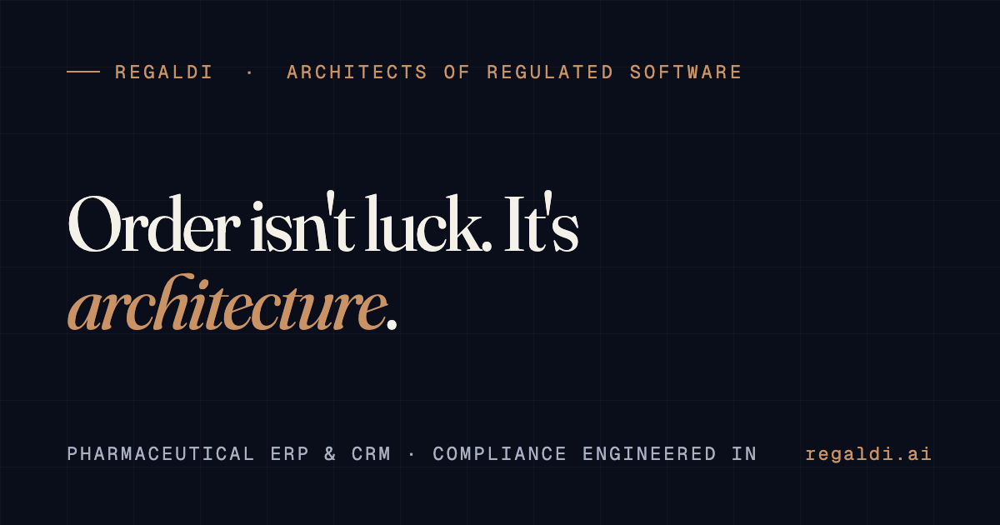

# Regaldi

Regaldi LLC develops and supports software for regulated businesses. We work with pharmaceutical and healthcare teams one workflow at a time: the software prepares and runs recurring work, and the licensed professional reviews, decides and signs.

**Website:** [regaldi.ai](https://regaldi.ai) · **Contact:** [office@regaldi.ai](mailto:office@regaldi.ai) · **LinkedIn:** [Regaldi](https://www.linkedin.com/company/108670457/) · **Facebook:** [Regaldi AI](https://www.facebook.com/people/Regaldi-AI/61579920770880/)

3119 W Hallandale Beach Blvd, Ste 102, Hallandale Beach, FL 33009

## Products

| Product | What it does |
|---|---|
| [Regaldi Legate](https://regaldi.ai/legate/) | An AI assistant for owner-led businesses, set up and supported by Regaldi. Accounts, recipients, channels and permitted work are agreed in writing before a workflow goes live; outgoing work is routed to the owner for approval. |
| [Regaldi Studio](https://regaldi.ai/studio/) | A desktop AI workspace for Mac and Windows where the person directs the work: research, documents and PDFs, video, their own files and browser, with a log of recorded actions. |
| [Regaldi Herald](https://regaldi.ai/herald/) | A compounding-pharmacy CRM for prescriber relationships and orders, in production at a compounding pharmacy since 2025. |
| [Regaldi Ledger](https://regaldi.ai/ledger/) | A 503B sterile-compounding ERP and system of record with 21 CFR Part 11 controls; built, with a GAMP 5 Category 5 validation package authored, and awaiting facility activation. |
| [Regaldi Quarry](https://regaldi.ai/labs/quarry/) | Florida land and public-records research with citations, sold by the order. Research, not a title opinion. |

Pricing is published on one page only: [regaldi.ai/pricing](https://regaldi.ai/pricing/).

## How we work

- **Assist under signature.** The software prepares the work; a person confirms, decides or signs. See [the assist layer](https://regaldi.ai/system/intelligence/).
- **Compliance by design.** Records, signatures and audit trails are mapped to the applicable rule, provision by provision. See [compliance architecture](https://regaldi.ai/system/compliance/).
- **Process maps by profession.** For each industry we publish which recurring work the software runs, which it prepares for a decision, and which stays with people. See [industries](https://regaldi.ai/industries/).
- **Practice notes.** Sourced explainers on the rules regulated software runs under: [regaldi.ai/notes](https://regaldi.ai/notes/).

## Limits

Regaldi provides software and research support. It does not replace licensed professional judgment or guarantee regulatory compliance. Regaldi is a software and implementation practice, not an FDA-approved or FDA-inspected entity; GAMP 5 validation is software validation, not FDA approval, clearance or inspection.

Our code repositories are private. Product access and implementation scope are agreed separately.

---

*Regaldi is read Reg·al·di: Regulated · Aligned · Digital. Regaldi LLC is not affiliated with companies named Regal AI or Regal.ai.*
